# 前言：Agent 课程脉络梳理，有方向感地学

面对 70 多节 Agent 开发课程，先不要急着逐节学习。把整条路线看清楚，才能知道要学什么、应该怎样学，以及学完后能够达到什么水平。

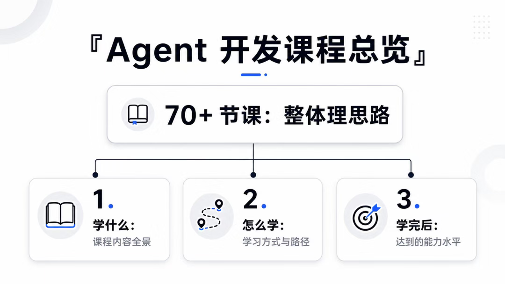

## 从终点倒推学习目标

假设你已经学完课程，准备应聘 Agent 全栈开发岗位，首先需要准备两样东西：

1. 一份能体现真实项目能力的 Agent 开发简历；
2. 一套覆盖核心知识点的 Agent 面试答题思路。

### 准备 Agent 项目简历

课程会提供知识库、智能客服、NL2SQL，以及医疗、法律等行业的真实 Agent 项目简历作为参考。阅读这些简历时，要重点关注：

- 项目背景：业务为什么需要 Agent；
- 技术栈：公司项目实际使用了哪些组件；
- 实现方案：RAG、工作流、记忆和工具调用如何落地；
- 项目成果：系统最终解决了什么问题。

下面是一份工业知识库 RAG-KG 项目的简历示例。它先用项目背景说明工业文档检索、证据追溯等业务痛点，再列出 Python、FastAPI、Milvus、OpenSearch、Redis、MinIO、Neo4j 和大模型等技术栈，最后从文档解析、图文分块、混合检索、知识图谱增强、权限控制与问答生成等方面描述个人工作。这种写法能够同时体现业务理解、技术选型和落地能力。

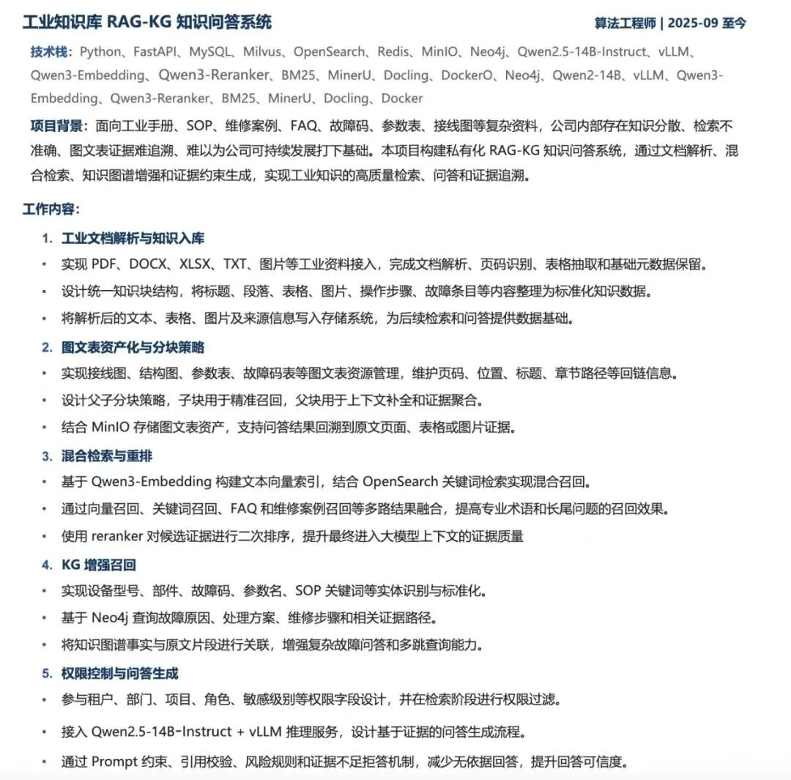

看得足够多，就会更清楚自己的简历应该怎样写，也能反向判断企业常用哪些技术方案、学习时应该把精力放在哪里。

### 准备高频面试题

面试题主要覆盖以下主题：

- RAG：检索策略、索引构建、重排、融合和向量数据库；
- Tool / MCP / Skill：工具调用、MCP 协议、Skill 设计与工具编排；
- LangGraph：状态图、节点、边、条件路由、循环和中断恢复；
- Memory：短期记忆、长期记忆、记忆结构、检索和更新策略；
- 评测：评测指标、数据集构建、自动化评测和人工评估；
- 大模型原理：Transformer、注意力机制、训练、推理与优化。

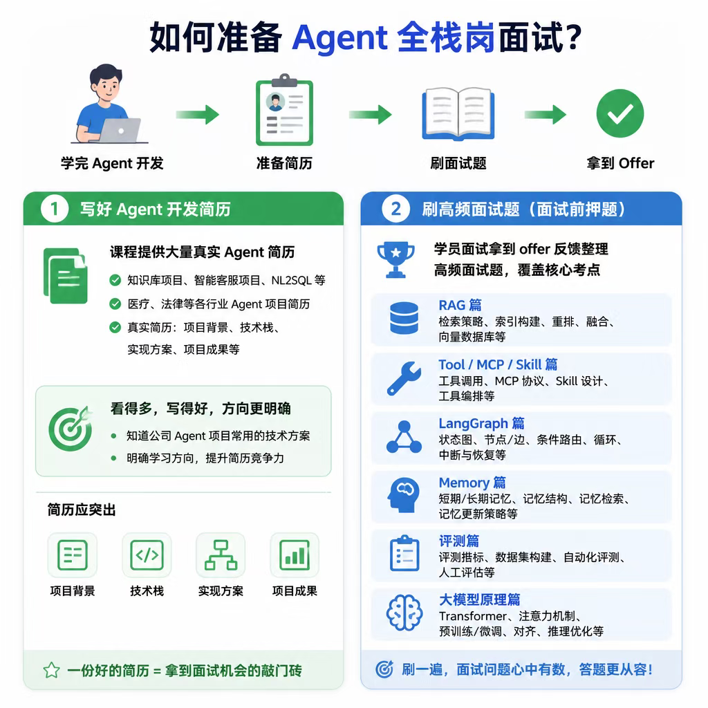

## 第一阶段：用 LangChain 学习 Agent 基础

课程首先基于 LangChain 学习 Agent 的核心组件：

- ChatModel
- Tool Call
- MCP
- RAG
- Memory
- Structured Output
- Prompt Template

LangChain 的核心能力，是通过 LCEL 等方式把模型、提示词、工具和输出解析等组件拼装成链式流程。Chain 适合线性任务，简单、直接、开发速度快。

但线性流程原生不擅长循环、多分支、并行和复杂跳转。业务一旦需要更复杂的状态控制，就要进入下一阶段。

## 第二阶段：用 LangGraph 编排复杂 Agent

LangGraph 复用 LangChain 的组件体系，并增加图编排能力：

- `State`：在节点之间传递和更新状态；
- `Node`：承载模型调用、工具执行等业务步骤；
- `Edge`：定义节点之间的流转关系；
- `Checkpoint`：保存执行状态，支持中断与恢复。

借助图模型，可以实现条件分支、循环、并行执行、多 Agent 协作和会话恢复等复杂能力。

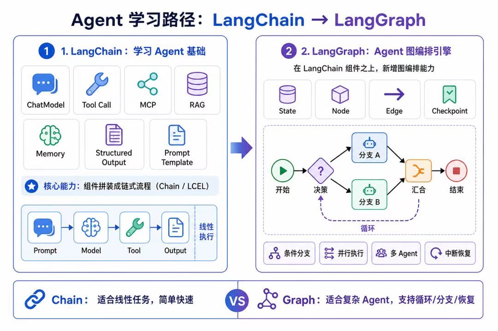

## 第三阶段：用 DeepAgents 快速构建高级 Agent

LangGraph 是底层编排框架，灵活度高，但任务规划、多 Agent、Skill 和记忆管理等通用能力往往需要自行实现。

DeepAgents 在 LangGraph 之上做了进一步封装，内置任务规划、多 Agent 协作、Skills、记忆与上下文管理、工具调用与工作流等能力，更适合快速搭建 Agent。想理解底层与深度定制，应掌握 LangGraph；想快速实现业务，可以使用 DeepAgents。

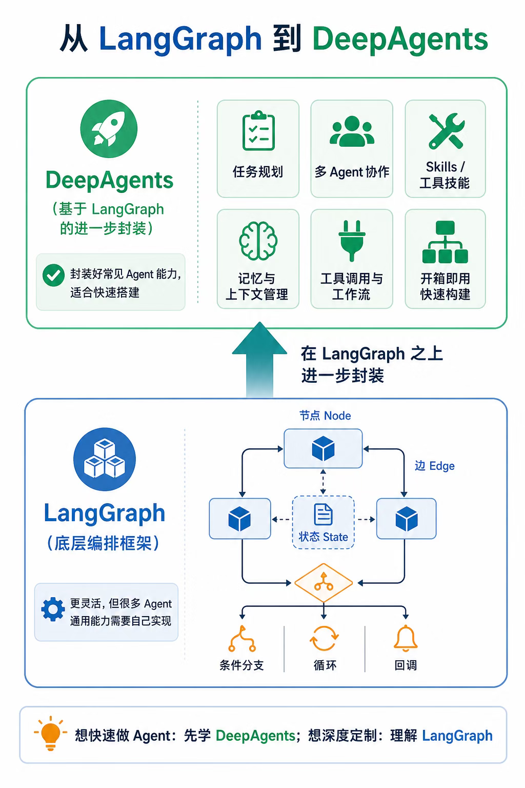

## 第四阶段：补齐业务后端能力

业务 Agent 运行在后端环境中，实际岗位通常要求具备全栈能力。课程会先使用 Docker Compose 搭建本地环境，再学习常见后端组件：

- **Milvus**：向量存储与相似度检索；
- **MySQL / PostgreSQL**：结构化数据的持久化存储；
- **Elasticsearch**：全文检索与分析；
- **Redis**：缓存、会话和短期记忆；
- **MinIO / RustFS**：文件与对象存储；
- **Neo4j**：知识图谱和关系分析；
- **RabbitMQ**：异步任务和消息队列；
- **NestJS**：Node.js 后端服务开发。

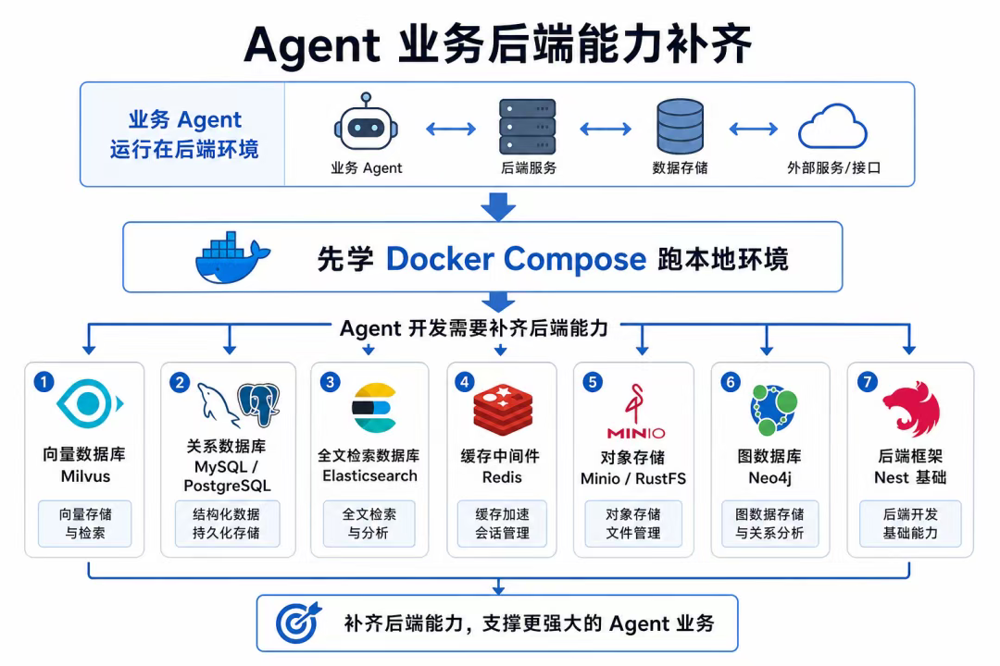

## 第五阶段：掌握可观测性与评测

Agent 的执行链路比普通接口更复杂。一次请求中可能包含用户输入、多轮模型思考、工具调用、工具返回和最终响应，因此需要使用 LangSmith、LangFuse 等方案记录完整链路。

重点观测的数据包括：

- 用户输入和最终输出；
- 模型与 Prompt 调用；
- 工具参数和执行结果；
- 错误堆栈；
- Token 消耗；
- 各阶段耗时。

可视化链路有助于定位死循环、参数错误、响应过慢和异常调用，同时也能开展检索相关性、答案相关性、上下文利用率与答案正确性等 RAG 评测实验。

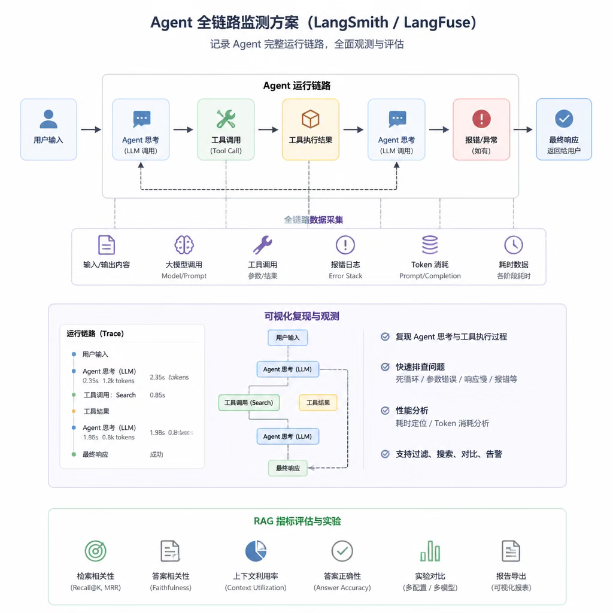

## 第六阶段：了解大模型基础原理

课程还会介绍 Transformer 架构、单向与双向注意力、训练与推理阶段，以及自回归生成等基础知识。

这部分的目标不是训练一个大模型，而是建立必要的底层认知，帮助你理解模型为什么逐 Token 生成内容，以及 Agent 在调用模型时受到哪些能力边界的约束。

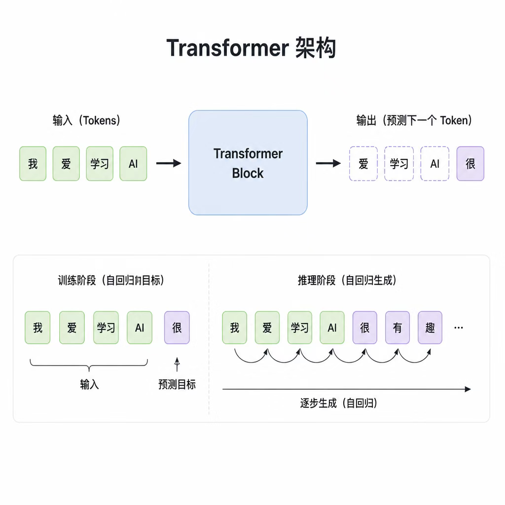

## 第七阶段：完成企业级知识库项目

项目实战会综合使用前面学到的 Agent 框架和后端技术，完成企业级知识库项目。

大量企业 Agent 需求都围绕 RAG 展开。一个完整的知识库应用通常包含：

1. 接入文档、网页和数据库等数据源；
2. 完成文档解析、文本分块、向量化和实体抽取；
3. 将内容写入向量数据库和知识图谱；
4. 结合向量检索与图谱检索进行混合召回；
5. 对候选结果重排、融合；
6. 由 Agent 完成意图识别、检索增强、答案生成和来源引用。

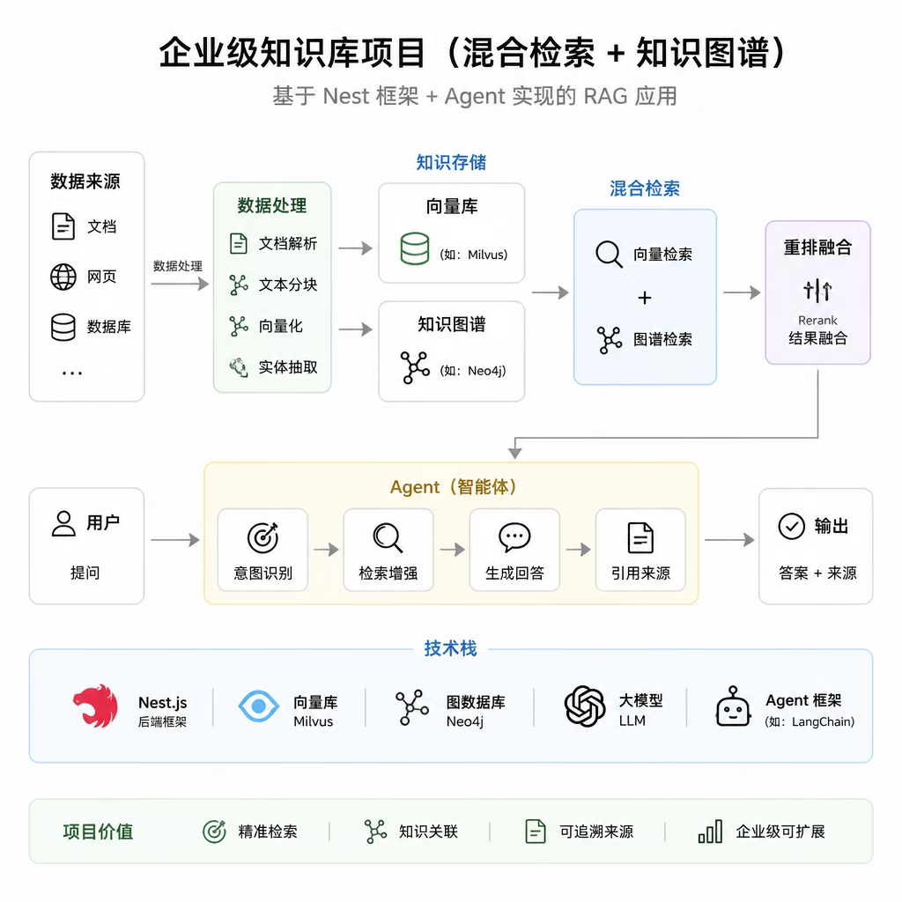

## 完整学习路线

整门课程可以概括为四个连续阶段：

1. **Agent 基础**：Tool、MCP、Memory、Prompt Template、RAG；
2. **Agent 框架**：LangChain、LangGraph、DeepAgents；
3. **后端基础**：Docker Compose、数据库、缓存、对象存储、消息队列和 NestJS；
4. **项目实战**：实现、优化并部署企业级知识库项目。

项目完成后，再结合真实简历梳理项目经验，并通过高频面试题查缺补漏。

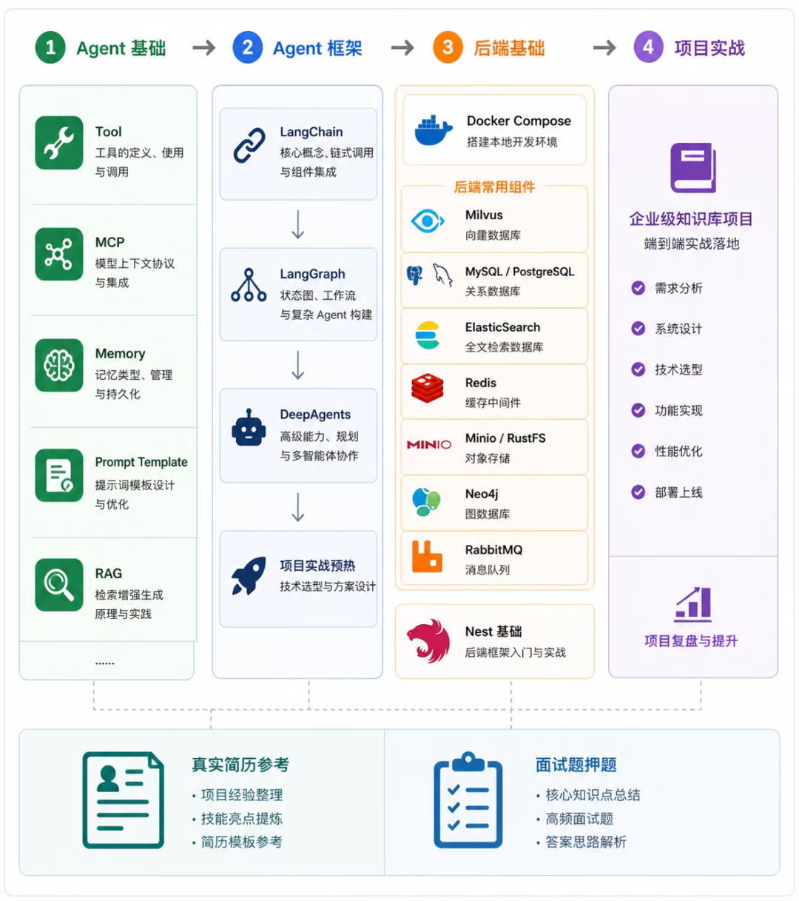

## 学习 Agent，不必被编程语言限制

课程使用 TypeScript 讲解，但 LangChain、LangGraph 在 Python 中的核心概念和 API 设计基本一致，Agent 的实现思路也不依赖某一种语言。

可以先使用自己熟悉的语言掌握 Agent 的核心能力。求职时，为了提高岗位匹配度，可以补充 Python 技能；入职后，也可以借助 AI 使用 Python 实现 Agent。

重点始终是 Agent 的设计与落地能力，编程语言只是工具，不是壁垒。

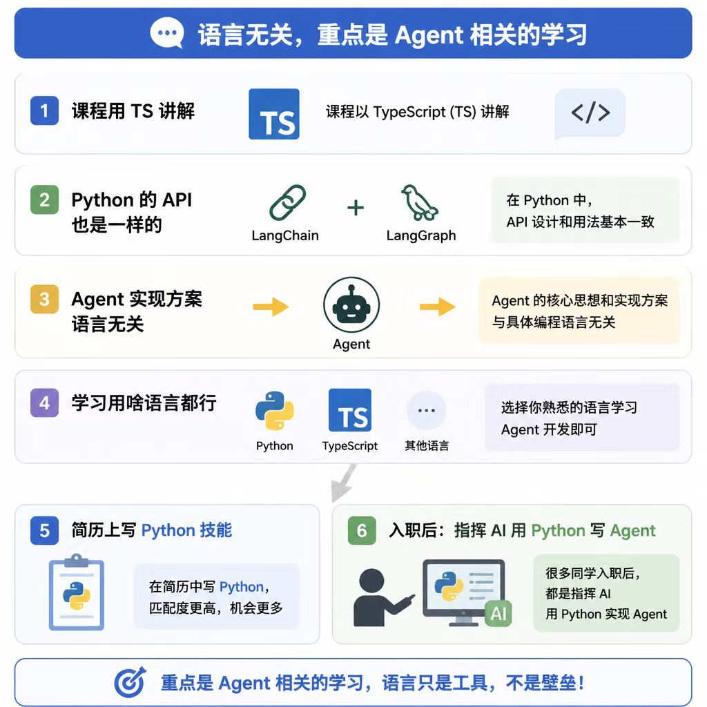

## 推荐的学习方式

课程采用“图文讲思路 + 视频看效果 + 视频讲代码”的组合：

- 图文适合快速理解结构，也便于回顾和检索；
- 效果演示能直观看到 Agent 的完整运行过程；
- 代码讲解用于深入理解关键实现和业务逻辑。

纯视频不方便快速定位知识点，纯图文又难以展示实际运行效果。三种形式结合，能兼顾理解效率、直观体验和实现细节。

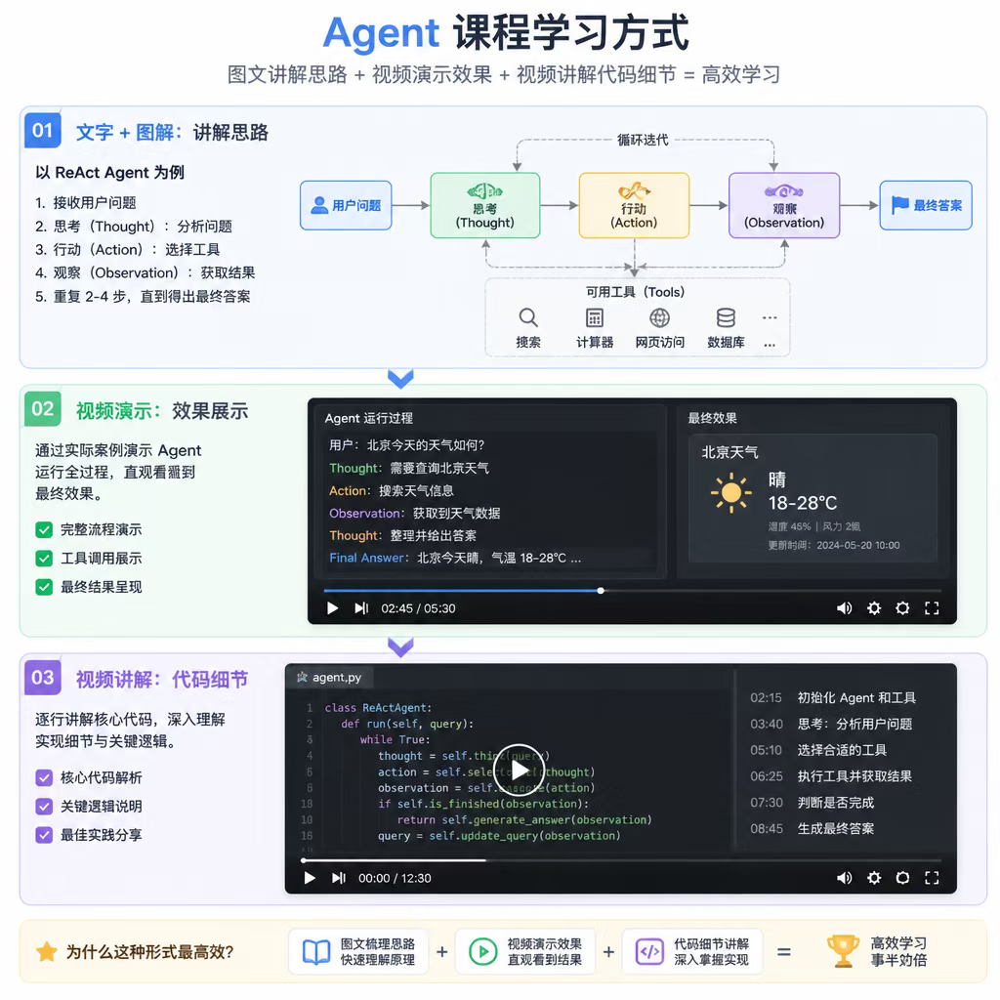

## 总结

这门课程的主线是：

> Agent 基础 → LangChain → LangGraph → DeepAgents → 后端能力 → 可观测与评测 → 企业级知识库项目 → 简历与面试

学习时不必一开始就掌握所有细节。先建立整条路线的方向感，再沿着基础、框架、后端和项目逐步深入。最终目标不是只会调用模型，而是能够把 Agent 做成可以运行、观测、评测、部署并服务真实业务的全栈产品。
