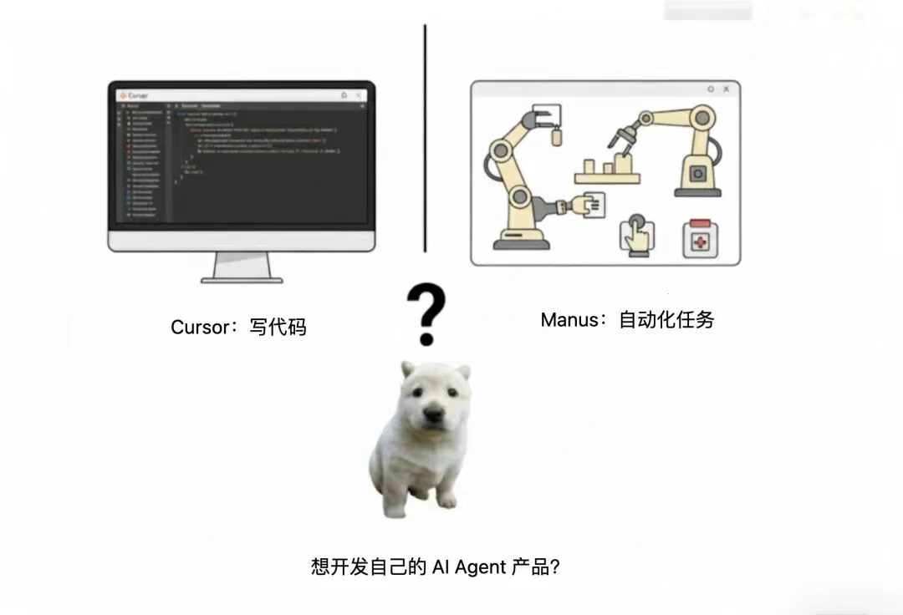
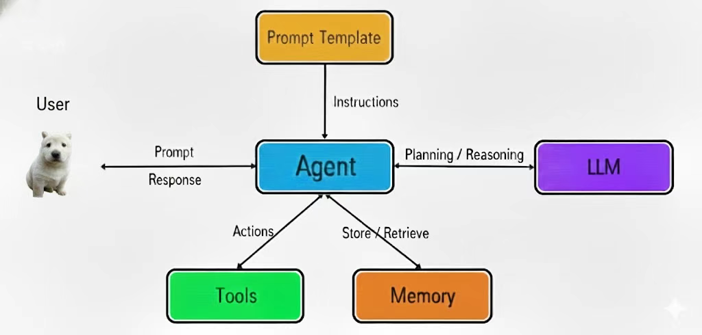
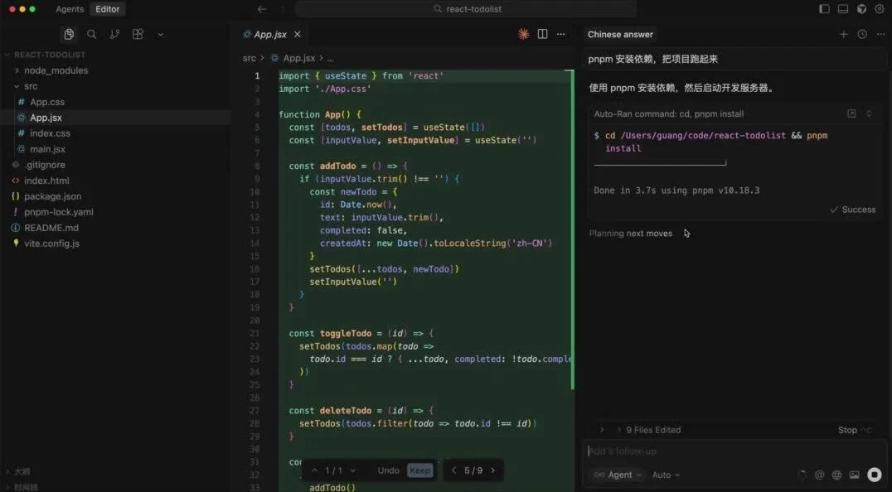
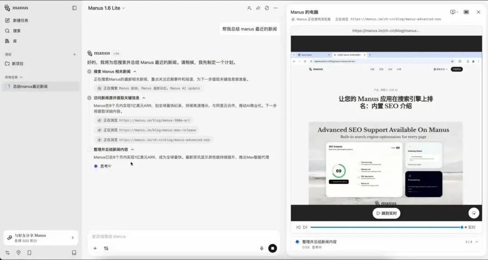
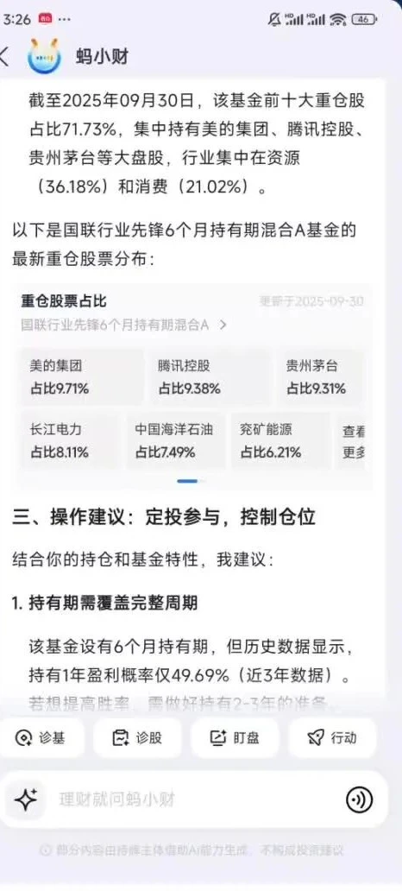

# AI Agent 开发要学什么？

我们每天都在使用各种 AI Agent：用 Cursor 编写和修改代码，用 Manus 自动完成网页访问、信息整理等任务。除了使用这些产品，你也可以进一步学习如何开发自己的 AI Agent。

## 为什么不能只调用大模型？

直接调用大模型可以完成问答和内容生成，但面对真实业务时，还会遇到几个关键问题：

- **记不住长期信息**：上周聊过的内容不会自动成为这周的长期记忆；
- **不能直接执行任务**：它可以给出访问网页、修改文件的思路，却没有对应工具时无法真正操作；
- **不了解私有知识**：公司内部文档没有出现在训练数据中，模型无法凭空回答；
- **不了解最新信息**：训练结束后发生的新闻和数据不在模型已有知识中。

解决这些问题，需要在大模型之外增加 Memory、Tool 和 RAG 等能力：

- 使用 **Memory** 管理需要保留和检索的记忆；
- 使用 **Tool** 让模型调用文件、浏览器、数据库和业务接口；
- 使用 **RAG** 从私有文档或最新数据中检索知识，再交给模型生成答案。

这些能力共同构成了 AI Agent 开发的核心。

## 什么是 Agent？

Agent 不是一个单独的大模型，而是以大模型为推理核心，并连接提示词、工具和记忆等组件的完整系统。

它能够理解用户目标，借助大模型进行思考和规划，根据需要调用工具，把重要信息写入或读出记忆，最后向用户返回结果。

可以把 Agent 概括为：

> Agent = 大模型的推理与规划能力 + Tool 执行能力 + Memory 记忆管理 + RAG 外部知识

经过这些扩展后，大模型不再只是回答问题，而是可以获取内部知识、记住必要信息，并实际完成任务。

## Tool：让 Agent 真正执行任务

### Cursor 如何读写文件和运行命令？

Cursor 能够创建文件、修改代码、安装依赖和执行命令，并不是因为大模型天然具备这些权限，而是因为它向模型提供了文件读写、代码检索和终端执行等工具。

模型负责判断要做什么，工具负责在真实环境中执行操作。

### Manus 如何自动操作浏览器？

Manus 可以打开浏览器、访问网页、点击页面元素、整理信息，并把结果写入 Markdown 文档。这一流程同样依赖浏览器操作、网页读取和文件写入等工具。

它会先规划任务，再按步骤调用工具，读取每一步的结果，并根据结果决定下一步行动。

这说明 Tool 不只是一个函数。对 Agent 而言，Tool 是连接模型与外部环境的行动接口。

## RAG：让 Agent 使用外部知识

支付宝中的理财助手可以查询基金持仓、历史数据并给出分析。这些具体数据并不是大模型本身天然知道的，而是由系统从内部数据源检索后提供给模型。

这类场景需要 RAG（Retrieval-Augmented Generation，检索增强生成）：

1. 接收用户问题；
2. 从知识库或业务数据中检索相关内容；
3. 把检索结果作为上下文交给大模型；
4. 基于可靠资料生成答案。

借助 RAG，Agent 可以访问企业私有文档和持续更新的数据，并减少仅凭模型已有知识回答带来的局限。

## Memory：让 Agent 管理记忆

模型一次能处理的上下文有限，也不会自动永久保存每次对话。Memory 的作用，是决定哪些信息需要记录、保存到哪里，以及以后在什么情况下重新取出。

常见的记忆可以分为：

- **短期记忆**：当前会话中的消息、临时状态和中间结果；
- **长期记忆**：用户偏好、历史任务和需要跨会话保留的信息；
- **业务状态**：工作流执行进度、工具结果和待完成步骤。

Memory 不是简单地保存全部聊天记录，而是对记忆进行筛选、组织、持久化和检索。

## 用什么框架开发 Agent？

### LangChain：组合 Agent 核心能力

LangChain 封装了模型调用、Prompt、Tool、Memory 和 RAG 等常用能力，可以把不同组件组合成完整的 Agent 流程。

课程使用 Node.js 版本学习 LangChain。Python 与 Node.js 版本虽然在语法上不同，但核心概念和实现逻辑相通。先用熟悉的语言掌握 Agent 技术，再切换语言并不困难。

### LangGraph：编排复杂流程和多 Agent

当任务涉及多个步骤、条件分支、循环、状态管理或多个 Agent 协作时，只靠线性流程维护交互会越来越复杂。

LangGraph 在 LangChain 组件之上提供图结构和状态管理能力，适合编排复杂 Agent 工作流，也可以用于组织多个 Agent 之间的协作。

因此，课程的框架学习路线是：

> Node.js → LangChain → LangGraph → 各类 Agent 应用

## 为什么还要学习后端？

Agent 最终需要运行在真实产品的后端环境中。记忆、知识、文件和任务状态都需要可靠的存储与服务支持，例如：

- 使用 Redis 保存缓存、会话或短期状态；
- 使用 MySQL 等关系数据库保存结构化业务数据；
- 使用向量数据库支持 RAG 检索；
- 使用后端接口连接企业系统和外部服务。

课程会把 AI 与后端技术结合起来，使用 NestJS 构建 Node.js 服务，目标不是只做一个调用模型的演示，而是开发能够真正落地的 AI 全栈产品。

## 学习路线总结

Agent 开发的重点不是单纯和大模型聊天，而是为模型扩展完成真实任务所需的能力：

1. 学习 **Tool**，让 Agent 可以操作外部环境；
2. 学习 **Memory**，管理短期与长期记忆；
3. 学习 **RAG**，接入私有知识和最新数据；
4. 学习 **LangChain**，组合模型、工具、记忆和检索；
5. 学习 **LangGraph**，编排复杂流程与多 Agent 协作；
6. 补齐 **Node.js、NestJS、Redis、MySQL** 等后端能力；
7. 将这些组件组合成可以运行、存储数据并服务真实用户的 AI 全栈产品。

Cursor、Manus 和理财助手等产品展示的，正是这些能力在不同业务中的组合。掌握核心组件及其协作方式，才具备把大模型能力落地为 Agent 产品的基础。
