# 前言：Agent 课程脉络梳理，有方向感的学

当你准备学习 Agent 开发，看到这门课 70 多节的目录，可能会迷茫：

这门课程都要学哪些内容？
应该用什么方式学？

学完后会达到什么水平？

这节就来整体理一下思路。

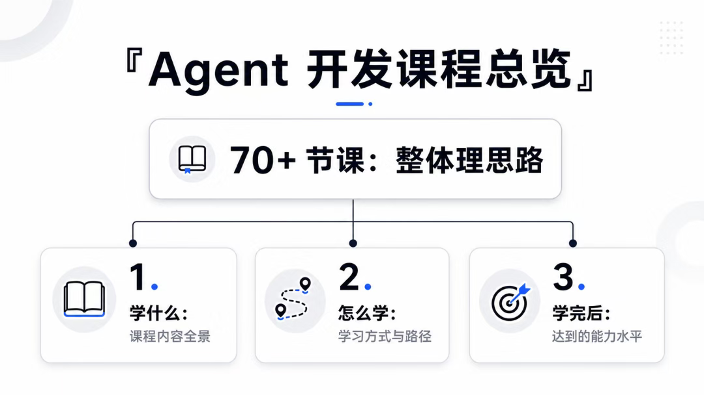

假设你现在已经学完 Agent 开发，要去找一份 Agent 全栈岗的工作，你要准备什么呢？

是不是要准备一份 Agent 开发的简历，然后刷一下常见 Agent 面试题。

首先写简历：

课程后面会提供大量的真实 Agent 简历。

有知识库项目、智能客服项目、NL2SQL 等项目，以及医疗、法律等各个行业的 Agent 项目，简历供你参考。

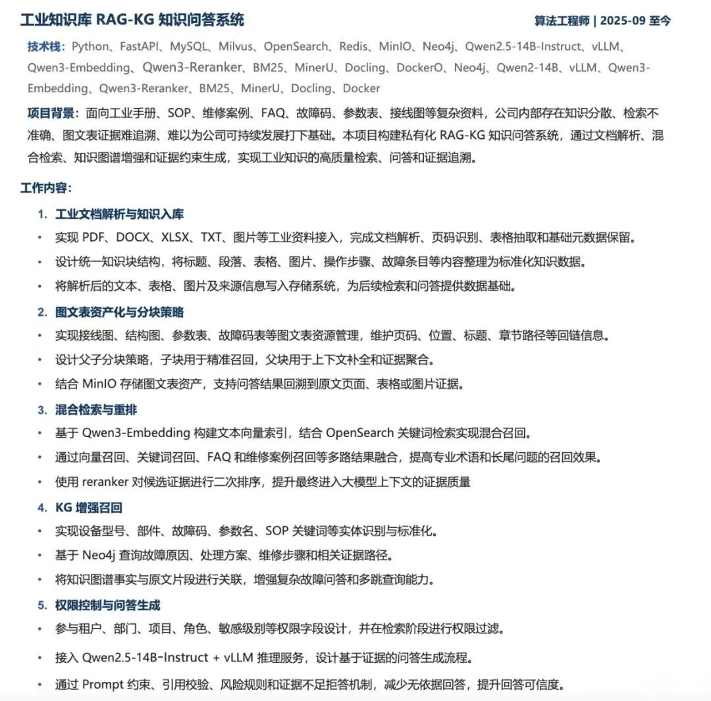

这些都是真实简历，你可以看一下他们的项目背景、技术栈、实现方案、项目成果等。

看得多了，你就知道你的 Agent 简历应该怎么写了。

而且也会更加明确学习方向：哪些是公司 Agent 项目常用的技术方案，应该学什么。

然后是面试题：

目前学员有很多都面试拿到 offer 了，回来给我反馈了很多面试题。

我收集整理了一波。

大概分成 RAG 篇、Tool / MCP / Skill 篇、LangGraph 篇、Memory 篇、评测篇、大模型原理篇等主题。

都是高频面试题，刷一遍之后 Agent 面试的各方面的问题，你会都有比较清晰的答题思路了。

算是面试前的押题。

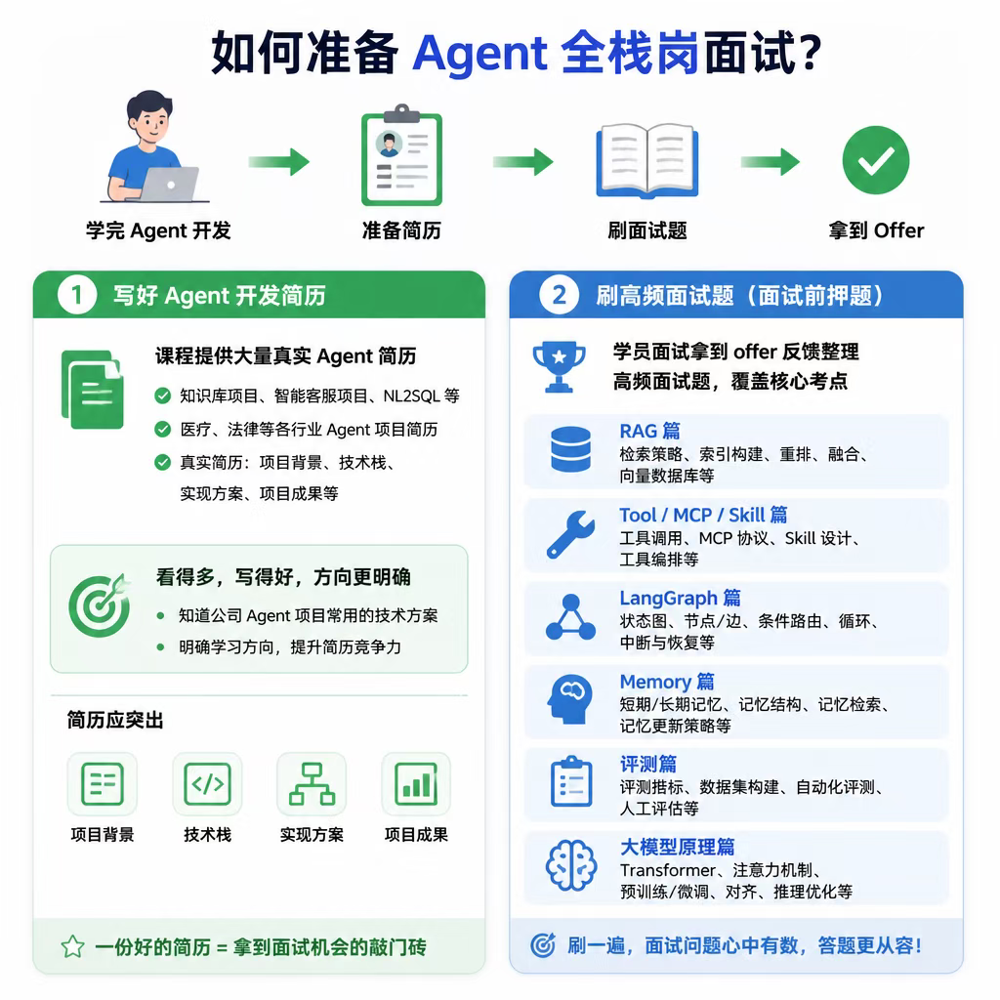

然后回过头来看下前面 Agent 学习过程：

首选我们会学习 LangChain，基于它来学 Agent 基础。

掌握 ChatModel、Tool Call、MCP、RAG、Memory、Structured Output、Prompt Template 这些核心组件。

LangChain 的核心能力是把各类组件拼装成链式流程（chain），通过 LCEL 声明式语法快速串联业务链路。

但 Chain 本质偏向线性执行，原生不支持循环、多分支、复杂跳转，面对复杂 Agent 场景能力受限。

所以接下来我们学习 LangGraph —— Agent 的图编排引擎。

它底层依旧复用 LangChain 的全套组件，在此之上新增了图编排能力：State 状态、节点、边、检查点 Checkpoint 等。

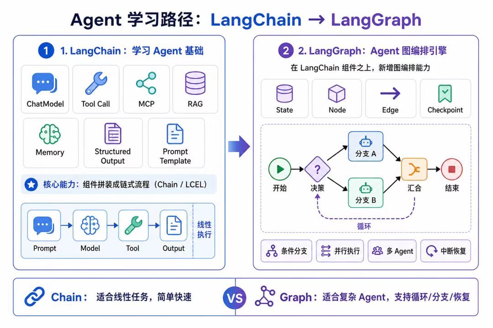

借助图模型，就可以实现循环、条件分支、并行执行、多 Agent、会话中断恢复等复杂能力。

不过 LangGraph 是底层编排框架，很多 Agent 通用能力都需要自己从零实现。

如果想用基于 LangGraph 进一步封装的方案，可以学一下 DeepAgents。

它内置了比如任务规划、多 Agent、Skill 等现成的能力，开箱即用。

所以接下来会学一下 DeepAgents。

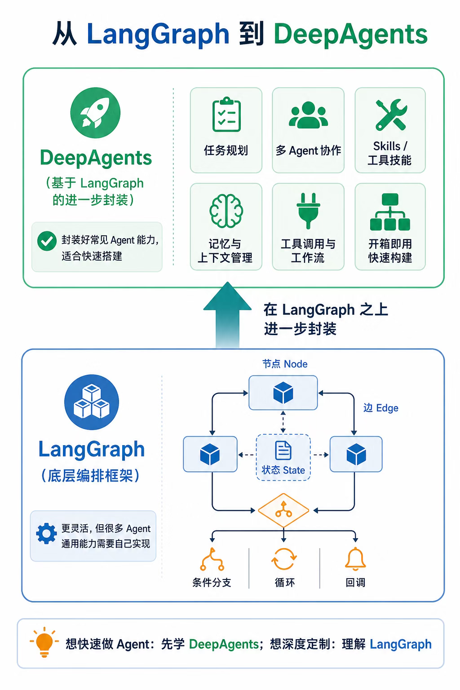

业务的 Agent 都是跑在后端环境的，市面上的 Agent 开发都是全栈岗。

所以我们要顺带补齐后端能力。

首先会讲 Docker Compose 跑本地环境。

然后讲一下后端常用组件：

- 向量数据库 Milvus
- 关系数据库 Mysql、PostgreSQL
- 全文检索数据库 ElasticSearch
- 缓存中间件 Redis
- 对象存储 Minio、RustFS
- 图数据库 Neo4j
- 消息队列 RabbitMQ

并且会讲一下后端框架 Nest 的基础。

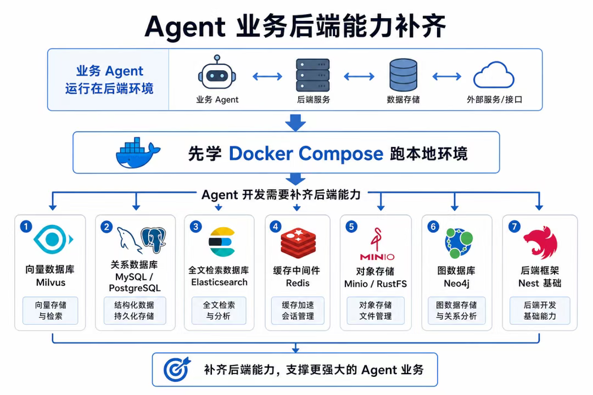

之后会查缺补漏，讲一下 Agent 的全链路监测方案 LangSmith、LangFuse，记录 Agent 完整运行链路。

比如：用户输入、大模型调用、工具调用、报错、token 消耗与耗时数据。

可视化复现 Agent 思考与工具执行过程。

方便排查死循环、参数错误、响应慢等问题，做全链路的观测。

并且还能跑一些 RAG 指标的评估实验。

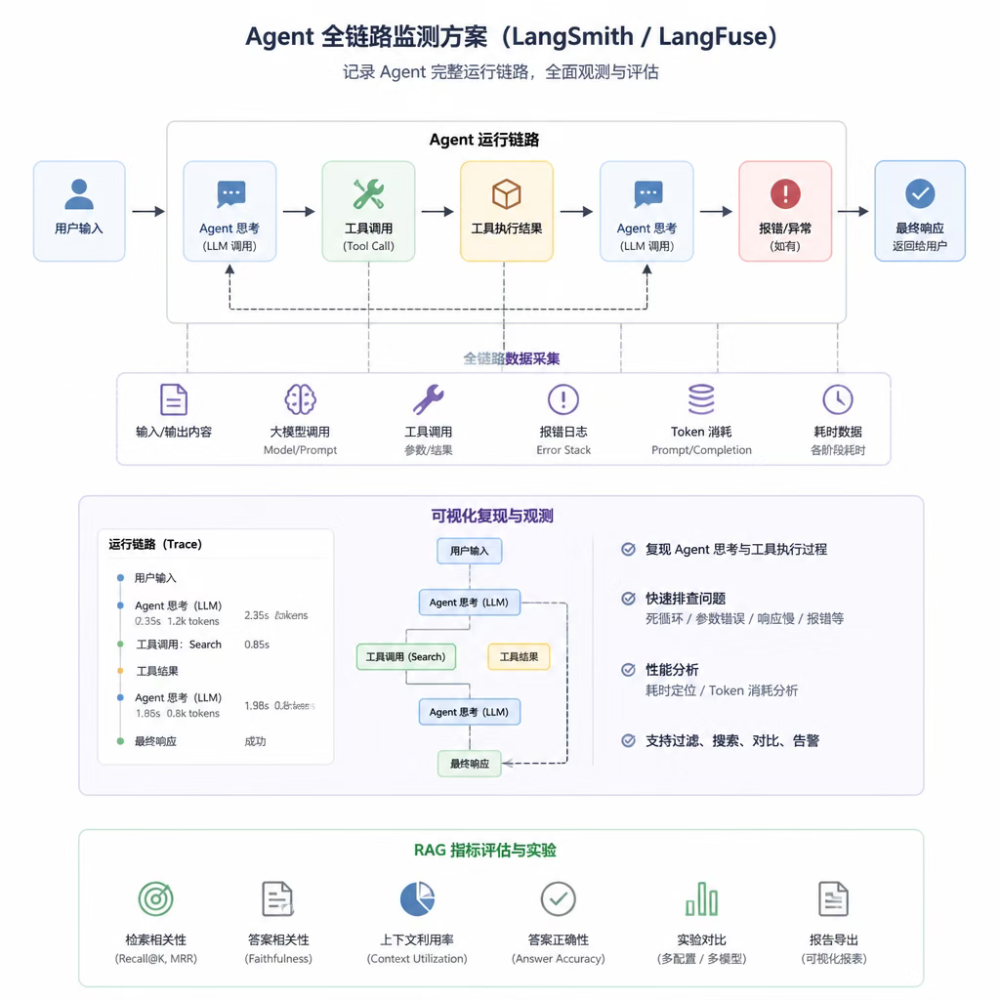

此外，还会讲解大模型底层原理，比如 Transformer 架构，单向、双向注意力，训练、推理阶段，自回归生成等。

当然，主要是学习 Agent 开发，大模型底层原理了解即可。

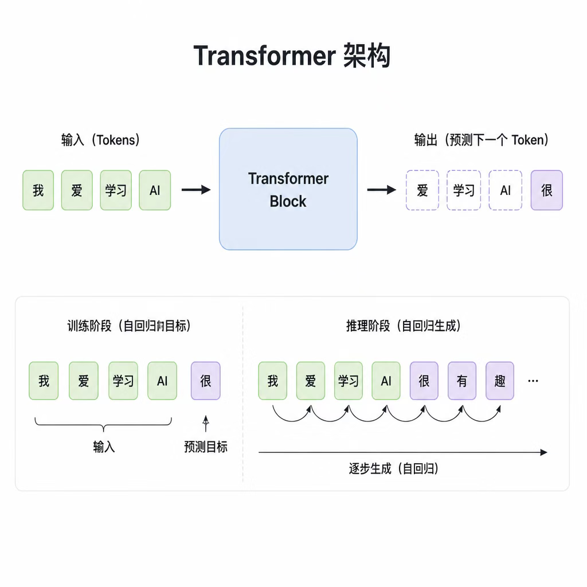

之后进入项目实战：企业级知识库项目。

会综合运用前面学到的后端技术、Agent 框架，实现知识库项目。

你看简历会发现，大部分公司 Agent 项目是围绕 RAG 来的，这说明公司需求主要是这个。

所以我们也做最适配企业需求的项目实战。

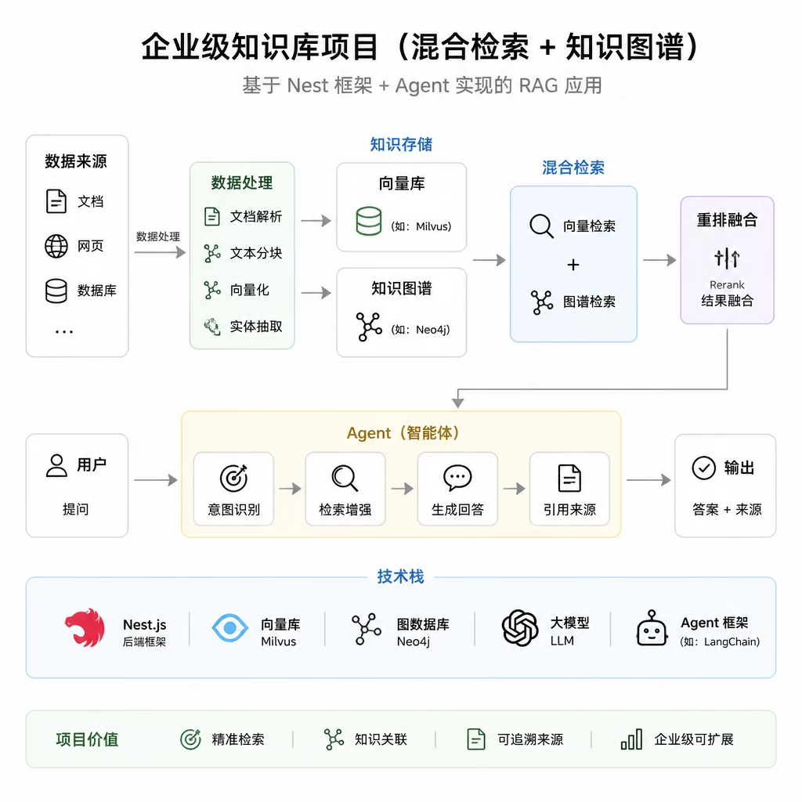

这就是整个课程的学习思路。

从 Agent 基础、Agent 框架、后端基础，到项目实战。

然后学完之后的真实简历参考，面试题押题，都包含。

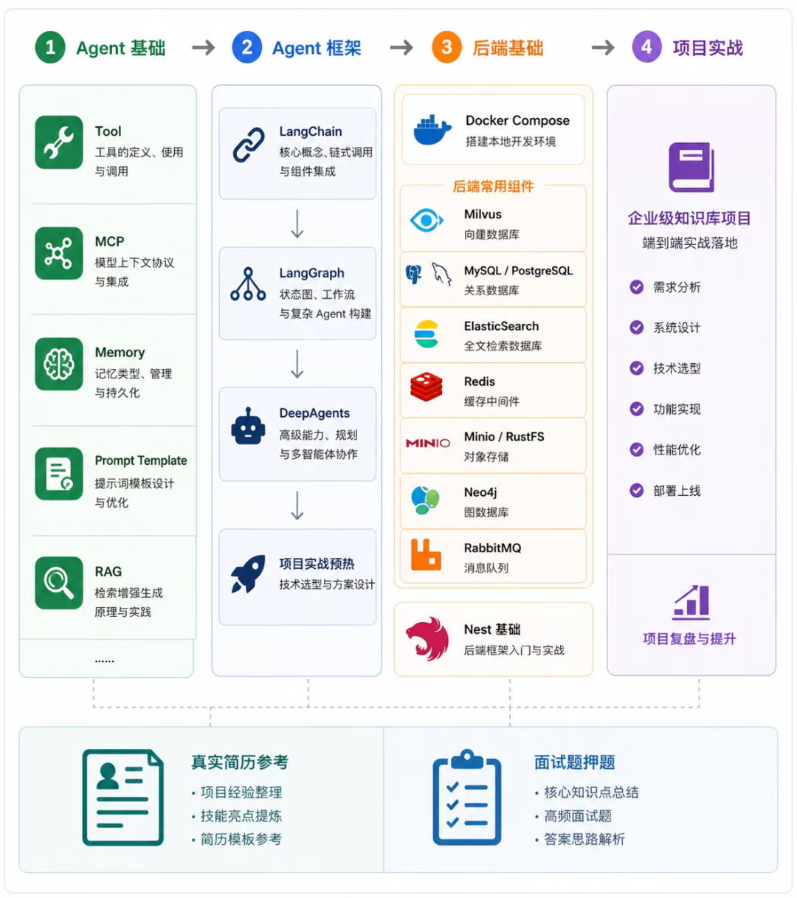

其实我和很多同学聊过（不可能保证就业，只是提供成功学员的面试经验分享）：有同学拿了不少 offer，从前端转 Agent 开发；也有同学顺利转型入职硬件公司；还有同学面试演示了 DeepAgents 那节的案例，然后就通过了。

当然也是因为现在 Agent 岗位多，比较容易进。

这里着重说一下语言的问题：

课程是用 ts 讲，但是 LangChain、LangGraph 的 api 在 python 里也是一样的，Agent 的实现方案是语言无关的。

所以学习 Agent 开发用啥语言都行。

但简历上可以写 python 技能，这样匹配度高一些。

很多同学学完入职后都是指挥 AI 用 python 写 Agent。

重点是 Agent 相关的学习，这是语言无关的。

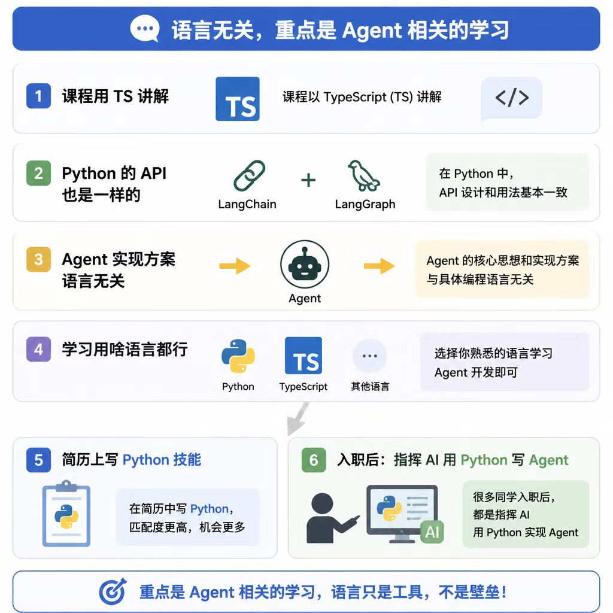

课程是文字 + 图解的形式讲解思路，然后视频演示，以及讲解具体代码细节。

很多学员都反馈，这是效率最高的形式。

纯视频太浪费时间，而且不好找内容。

纯图文又不直观，看不到效果。

所以图文 + 视频的形式是最好的。

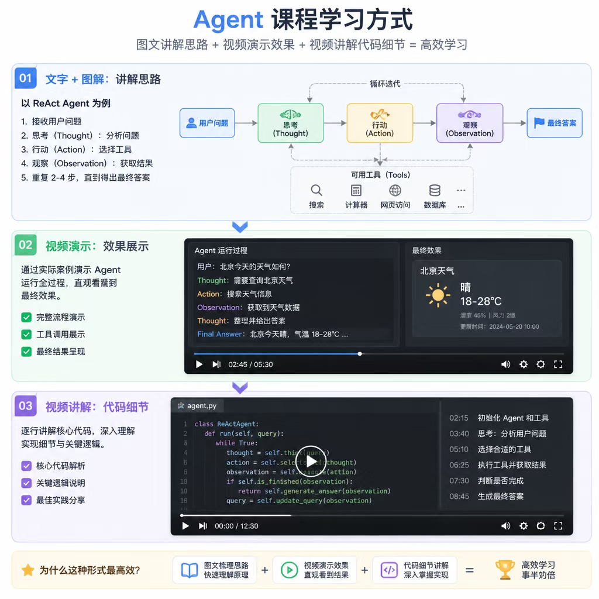

最后说一下代码仓库：之前是放在 github 的，所以章节后面会有 github 的链接；但后来转移到了 gitcode 的私有组织。gitcode 组织下除了代码仓库，还会放一些简历仓库，以及其他学员分享的一些东西。

## 总结

这节讲了一下课程的脉络，帮大家理清学习思路。

我们会先从 LangChain 开始，基于它学习 Agent 基础，然后学习 LangGraph 图编排引擎，以及 DeepAgents。

之后学习后端基础，Docker Compose、PostgreSQL、Redis、ElasticSearch、RabbitMQ、Minio、Milvus 等。

然后实现企业级知识库项目，把前面学的综合运用一遍。

之后会给很多真实 Agent 简历参考，你可以借鉴这些来理清思路，以及写自己的简历。

最后是很多真实 Agent 面试题，帮你在面试前押题，面试的时候就有清晰的答题思路了。

大概有这个路线的概念，后面学起来就更有方向感了。
